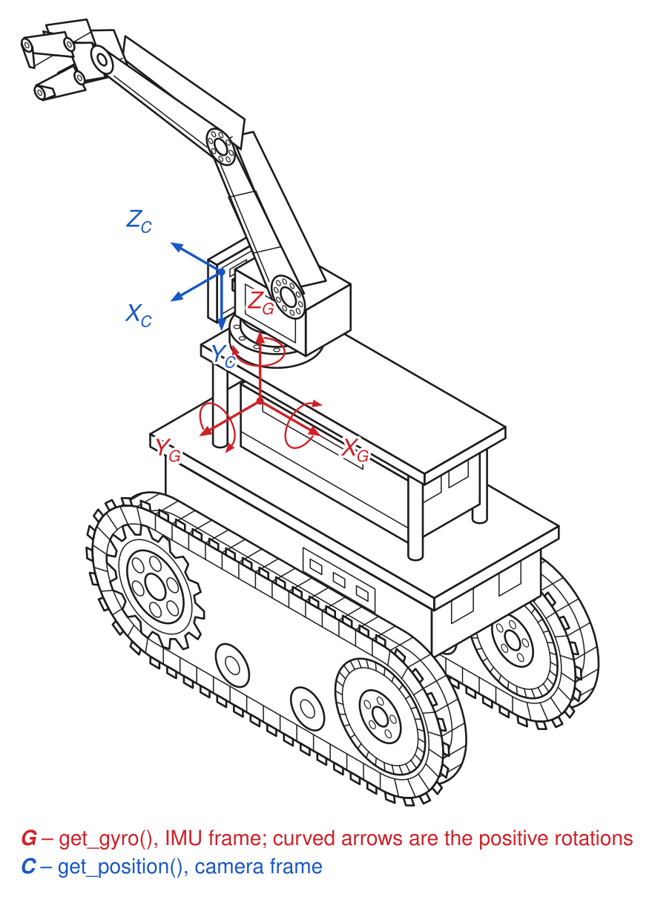

<style>
body, p, h1, h2, h3, h4, h5, h6, li, td, th, blockquote {
    direction: rtl;
    text-align: right;
}
code, pre { direction: ltr; text-align: left; unicode-bidi: embed; }
</style>

<div dir="rtl">

# RaspTankPro — מדריך תכנות לסטודנטים

מדריך זה מסביר כיצד לכתוב תוכניות לרובוט באמצעות **סביבת הסנדבוקס**. תשתמשו בפייתון וסט פשוט של פקודות — אין צורך בידע קודם בחומרה או אלקטרוניקה.

---

## תוכן העניינים

1. [סקירת החומרה](#1-סקירת-החומרה)
2. [תחילת עבודה](#2-תחילת-עבודה)
3. [תנועה](#3-תנועה)
4. [חיישנים](#4-חיישנים)
5. [סרוויים וזרוע](#5-סרוויים-וזרוע)
6. [אודומטריה ויזואלית (מעקב מיקום)](#6-אודומטריה-ויזואלית-מעקב-מיקום)
7. [תצוגה ו-LEDs](#7-תצוגה-ו-leds)
8. [תוכניות לדוגמה](#8-תוכניות-לדוגמה)
9. [הרצת בדיקות החומרה](#9-הרצת-בדיקות-החומרה)
10. [פתרון בעיות](#10-פתרון-בעיות)

---

## 1. סקירת החומרה

<table dir="rtl">
<thead><tr><th>רכיב</th><th>תיאור</th></tr></thead>
<tbody>
<tr><td><strong>מנועי הנעה</strong></td><td>שני מנועים (שמאל וימין) לשליטה בתנועה ובפנייה</td></tr>
<tr><td><strong>סרוויים</strong></td><td>חמישה סרוויים: סיבוב זרוע שמאל-ימין, זרוע למעלה-למטה, יד למעלה-למטה, אחיזה פתוח-סגור, הטיית מצלמה למעלה-למטה</td></tr>
<tr><td><strong>חיישן אולטרסוני</strong></td><td>מודד מרחק למכשול הקרוב ביותר (במטרים)</td></tr>
<tr><td><strong>MPU6050</strong></td><td>ג'ירוסקופ ומד-תאוצה משולבים (מהירות זוויתית + תאוצה)</td></tr>
<tr><td><strong>מצלמה</strong></td><td>מצלמת Raspberry Pi, משמשת לשידור הווידאו ולאודומטריה ויזואלית</td></tr>
<tr><td><strong>רצועת LED</strong></td><td>16 נורות RGB NeoPixel</td></tr>
<tr><td><strong>תצוגת OLED</strong></td><td>מסך SSD1306 קטן עם 6 שורות טקסט</td></tr>
</tbody>
</table>

---

## 2. תחילת עבודה

### הפעלת הרובוט

1. הרובוט מופעל אוטומטית כאשר הוא מחובר למקור חשמל.
2. חברו מקלדת, עכבר וצג אם אתם צריכים לכתוב או לערוך תוכניות.
3. **Thonny IDE** נפתח אוטומטית עם `sandbox.py` טעון — זו סביבת התכנות שלכם.

### כתיבה והרצה של התוכנית

1. הגדירו את פונקציות העזר שאתם צריכים באזור **הפונקציות** שמעל `run()` — יש שם פונקציה לדוגמה שמראה את הפורמט.
2. כתבו את התוכנית הראשית שלכם בתוך פונקציית `run()`.
3. לחצו **F5** (או לחצו על כפתור ה-Run ב-Thonny) להרצת התוכנית.
   - שרת הבקרה המקוון מופסק אוטומטית כאשר לוחצים Run.
   - החומרה של הרובוט זמינה עכשיו באופן בלעדי לתוכנית שלכם.
4. לחצו על כפתור **Stop** (או **F2**) בכל עת לעצירה בטוחה של הרובוט.

שרת הבקרה המקוון נשאר מופסק עד לאתחול הרובוט. ניתן ללחוץ F5 שוב ושוב בינתיים — אך הדף בדפדפן לא יעבוד שוב עד שתאתחלו את הרובוט.

### מעבר בין מצב שרת הבקרה המקוון למצב Sandbox

הקובץ `~/startup.sh` ‏(`/home/pi/startup.sh`) קובע מה הרובוט מריץ בעת האתחול.
פתחו אותו בעורך טקסט (לדוגמה: `nano ~/startup.sh`) ושנו את ה-comments:

**מצב שרת הבקרה המקוון** (ברירת מחדל — שליטה ברובוט דרך דפדפן):

<div dir="ltr">

```sh
# Comment this line when working in sandbox:
sudo python3 /home/pi/adeept_rasptankpro/server/webServer.py

# Uncomment this line when working in sandbox:
#sudo python3 /home/pi/adeept_rasptankpro/server/sandbox.py
```

</div>

**מצב Sandbox** (הרובוט מריץ את פונקציית `run()` שלכם אוטומטית בעת האתחול):

<div dir="ltr">

```sh
# Comment this line when working in sandbox:
#sudo python3 /home/pi/adeept_rasptankpro/server/webServer.py

# Uncomment this line when working in sandbox:
sudo python3 /home/pi/adeept_rasptankpro/server/sandbox.py
```

</div>

שמרו את הקובץ ואתחלו מחדש. הרובוט יתחיל במצב שנבחר.

### עצירת חירום

אם הרובוט בורח או מתנהג בצורה בלתי צפויה ואינכם יכולים להגיע ל-Thonny:
- לחצו פעמיים על האייקון **EMERGENCY STOP** בשולחן העבודה.
- פעולה זו מפסיקה מיידית את התוכנית הרצה ועוצרת את המנועים.

---

## 3. תנועה

כל פונקציות התנועה מקבלות `speed` (מהירות, 0–100) ו-`duration` אופציונלי בשניות.
אם `duration` לא מצוין, הרובוט ימשיך לנוע עד שתקראו ל-`robot.stop()`.

<div dir="ltr">

```python
robot.forward(speed=50, duration=2.0)   # Move forward for 2 seconds at half speed
robot.backward(speed=50, duration=1.0)  # Move backward for 1 second
robot.turn_left(speed=50, duration=0.5) # Pivot turn (one track drives, the other stops)
robot.turn_right(speed=50, duration=0.5)# Pivot turn the other way
robot.turn_left(speed=50, duration=2.0, radius=0.5)  # Wider arc: the other track runs at half speed
robot.spin_left(speed=40, duration=1.0) # Spin in place counter-clockwise
robot.spin_right(speed=40, duration=1.0)# Spin in place clockwise
robot.stop()                            # Stop immediately
robot.wait(1.5)                         # Block for 1.5 s — motors keep running if already on
```

</div>

### תיאור הפונקציות

#### `robot.forward(speed=50, duration=None)`
נוע קדימה.
- `speed` — עוצמת מנוע, 0–100 (ברירת מחדל: 50)
- `duration` — שניות לנסיעה; אם `None`, נוסע עד לקריאה ל-`stop()`

#### `robot.backward(speed=50, duration=None)`
נוע אחורה. אותם פרמטרים כמו `forward`.

#### `robot.turn_left(speed=50, duration=None, radius=0)`
פנייה תוך כדי נסיעה קדימה. עם `radius=0` זו פניית ציר: זחל אחד נוסע קדימה בעוד השני עוצר. בדקו על הרובוט שלכם לאיזה כיוון הוא מסתובב בפועל — זה תלוי בחיווט המנועים.
- `speed` — עוצמת הזחל המהיר, 0–100 (ברירת מחדל: 50)
- `duration` — שניות לפנייה; אם `None`, פונה עד לקריאה ל-`stop()`
- `radius` — 0 עד 1 (ברירת מחדל: 0; ערכים מחוץ לטווח מקוצצים לגבול). הזחל השני נע בעוצמה `speed × radius`. `0` מסתובב במקום, ערך גדול יותר נותן קשת רחבה יותר, ו-`1` נוסע ישר. זהו יחס ולא מטרים. עוצמה נמוכה מאוד בזחל האיטי עלולה לא להזיז אותו.

#### `robot.turn_right(speed=50, duration=None, radius=0)`
כמו `turn_left`, בכיוון ההפוך. אותם פרמטרים, כולל `radius`.

#### `robot.spin_left(speed=50, duration=None)`
סתובב נגד כיוון השעון במקום. שני הגלגלים נעים באותה מהירות בכיוונים מנוגדים.

#### `robot.spin_right(speed=50, duration=None)`
סתובב עם כיוון השעון במקום.

#### `robot.stop()`
עצור את כל המנועים מיידית.

#### `robot.wait(seconds)`
חסום ביצוע למשך מספר השניות הנתון — התוכנית לא עושה דבר בזמן זה. **כל מנוע שכבר פעל ימשיך לפעול.** השתמשו ב-`robot.stop()` לפני או אחרי `wait()` אם רוצים שהרובוט יעמוד במקום.

---

## 4. חיישנים

### חיישן מרחק

<div dir="ltr">

```python
distance = robot.get_distance()
print(f"Obstacle is {distance:.2f} metres away")
```

</div>

#### `robot.get_distance()` → `float`
מחזיר את המרחק (ב**מטרים**) למכשול הקרוב ביותר ישירות מול החיישן.
ערכים מעל ~2 מטר עשויים להיות לא מדויקים. מחזיר `-1.0` אם החיישן לא מגיב
(מנותק או תקול) — תמיד בדקו זאת לפני שימוש בערך.

---

### ג'ירוסקופ

<div dir="ltr">

```python
gyro = robot.get_gyro()
print(f"Rotation — x: {gyro['x']:.2f}  y: {gyro['y']:.2f}  z: {gyro['z']:.2f}  °/s")
```

</div>

#### `robot.get_gyro()` → `dict`
מחזיר מהירות זוויתית ב**מעלות לשנייה** כמילון עם מפתחות `'x'`, `'y'`, `'z'`.
אלו קצבי סיבוב, לא זוויות — ראו [חישוב כיוון מהג'ירוסקופ](#חישוב-כיוון-מהגירוסקופ) בהמשך.

החיישן מותקן כך שציר ה-x שלו מצביע **אחורה**, ציר ה-y **ימינה**, וציר ה-z **למעלה**:

<table dir="rtl">
<thead><tr><th>ציר</th><th>סיבוב</th><th>ערך חיובי פירושו</th></tr></thead>
<tbody>
<tr><td><code>x</code></td><td>גלגול (הטייה לצדדים)</td><td>הצד השמאלי יורד</td></tr>
<tr><td><code>y</code></td><td>הצעדה (הטייה קדימה/אחורה)</td><td>החזית מתרוממת</td></tr>
<tr><td><code>z</code></td><td>פנייה (סיבוב שמאל/ימין)</td><td>פנייה <strong>שמאלה</strong> (נגד כיוון השעון, במבט מלמעלה)</td></tr>
</tbody>
</table>

<div dir="ltr">



</div>

מחזיר `{'x': 0, 'y': 0, 'z': 0}` אם החיישן אינו מחובר.

---

### חישוב כיוון מהג'ירוסקופ

הג'ירוסקופ מודד כמה **מהר** הרובוט מסתובב, ולא לאיזה כיוון הוא פונה. כדי לקבל כיוון עליכם לסכם את המהירות הזוויתית לאורך זמן בעצמכם:

<div dir="ltr">

```python
def run():
    heading = 0.0      # degrees, measured from wherever the robot starts
    dt = 0.05

    robot.spin_left(speed=40)
    while heading < 90.0:
        heading += robot.get_gyro()['z'] * dt
        robot.wait(dt)

    robot.stop()
    print(f"Turned {heading:.1f} degrees")
```

</div>

שני דברים שכדאי לצפות להם:

- **יש סחיפה.** בכל קריאה יש שגיאה קטנה, וסכימת הקריאות סוכמת גם את השגיאות. אחרי דקה של סיבוב הכיוון עשוי לסטות בכמה מעלות, והשגיאה הזו אינה מתקנת את עצמה.
- **אין מצפן.** ל-MPU6050 יש ג'ירוסקופ ומד-תאוצה אך אין מגנטומטר, ולכן שום דבר אינו מספר לרובוט היכן הצפון. הכיוון שאתם מחשבים הוא תמיד יחסי לכיוון שבו הרובוט הצביע כאשר התוכנית התחילה.

> **זהירות — ל-`z` יש שתי משמעויות שונות.** ‏`get_gyro()['z']` הוא סיבוב סביב הציר **האנכי**. ה-`z` שמוחזר מ-`get_position()` הוא הכיוון **קדימה**. אלו צירים שונים; האיור שלמעלה מציג את שתי מערכות הצירים זו לצד זו.

---

### מד-תאוצה

<div dir="ltr">

```python
accel = robot.get_accel()
print(f"Acceleration — x: {accel['x']:.2f}  y: {accel['y']:.2f}  z: {accel['z']:.2f}  g")
```

</div>

#### `robot.get_accel()` → `dict`
מחזיר תאוצה ליניארית ב**g** (1 g ≈ 9.81 מ/ש²) כמילון עם מפתחות `'x'`, `'y'`, `'z'`.
כאשר הרובוט שטוח ובמנוחה, `z ≈ 1.0` (כבידה) ו-`x ≈ y ≈ 0`.

מחזיר `{'x': 0, 'y': 0, 'z': 1}` אם החיישן אינו מחובר.

---

## 5. סרוויים וזרוע

כל פונקציות הסרוו מקבלות **position** (מיקום) בין `-1.0` (קצה אחד) ל-`+1.0` (הקצה השני), כאשר `0.0` הוא המרכז.

<div dir="ltr">

```python
robot.set_arm_rotation(-0.5) # Rotate arm halfway to the left
robot.set_arm(0.8)           # Raise arm 80% of the way up
robot.set_hand(0.5)          # Raise hand halfway up
robot.set_gripper(-1.0)      # Close gripper fully
robot.set_gripper(1.0)       # Open gripper fully
robot.set_camera_tilt(1.0)   # Tilt camera fully up
robot.reset_servos()         # Return all servos to centre
```

</div>

### תיאור הפונקציות

#### `robot.set_arm_rotation(position)`
סובב את הזרוע שמאלה או ימינה (סיבוב הגוף).
- `-1.0` = שמאל מלא, `0.0` = מרכז, `+1.0` = ימין מלא

#### `robot.set_arm(position)`
הזז את מפרק הזרוע למעלה או למטה.
- `-1.0` = לחלוטין למטה, `0.0` = מרכז, `+1.0` = לחלוטין למעלה

#### `robot.set_hand(position)`
הזז את היד (פרק כף היד / אמה) למעלה או למטה.
- `-1.0` = לחלוטין למטה, `0.0` = מרכז, `+1.0` = לחלוטין למעלה

#### `robot.set_gripper(position)`
פתח או סגור את האחיזה.
- `-1.0` = סגור לחלוטין, `0.0` = מרכז, `+1.0` = פתוח לחלוטין

#### `robot.set_camera_tilt(position)`
הטה את המצלמה למעלה או למטה.
- `-1.0` = למטה מלא, `0.0` = מרכז, `+1.0` = למעלה מלא

#### `robot.reset_servos()`
החזר את כל הסרוויים למיקום המרכזי שלהם (מיקום `0.0`).

---

## 6. אודומטריה ויזואלית (מעקב מיקום)

אודומטריה ויזואלית מעריכה את מיקום הרובוט על-ידי ניתוח התנועה בין פריימים עוקבים של המצלמה. היא משתמשת ב**זיהוי נקודות FAST** ו**זרימה אופטית לוקאס-קאנדה** כדי לעקוב כיצד הסצנה משתנה מפריים לפריים, ואז מחשבת את ההזזה התלת-מימדית של המצלמה.

### מה המשמעות של שלושת המספרים

`get_position()` מחזיר `(x, y, z)` הנמדדים במערכת הצירים של **המצלמה**, ולא של הרובוט:

<table dir="rtl">
<thead><tr><th>ערך</th><th>כיוון</th><th>למה הוא משמש</th></tr></thead>
<tbody>
<tr><td><code>x</code></td><td>לצדדים, לימין הרובוט</td><td>תנועה לצדדים</td></tr>
<tr><td><code>y</code></td><td>אנכית, כלפי מטה</td><td>לא שימושי — על רצפה שטוחה יישאר סביב 0</td></tr>
<tr><td><code>z</code></td><td><strong>קדימה</strong>, הכיוון שאליו המצלמה מביטה</td><td>כמה הרובוט נסע</td></tr>
</tbody>
</table>

לכן, כדי לשרטט את המסלול שהרובוט עבר במבט מלמעלה, שרטטו **`x` מול `z`** — ולא `x` מול `y`. האיור ב[סעיף 4](#4-חיישנים) מציג מערכת צירים זו בכחול, לצד זו של הג'ירוסקופ.

### מגבלות חשובות

> **אי-בהירות סקאלה חד-עינית:** מצלמה בודדת אינה יכולה לקבוע מרחקים אמיתיים ללא מקור ייחוס חיצוני. ערכי x, y, z המוחזרים על-ידי `get_position()` הם ב**יחידות יחסיות**, לא מטרים. הסקאלה תלויה ב-`absolute_scale` (ברירת מחדל: 1.0). אם דרושים לכם מרחקים אמיתיים, יש לכייל ערך זה ביחס למרחק ידוע.

> **סחיפה:** האודומטריה הויזואלית צוברת שגיאות קטנות עם הזמן. מסלולים ארוכים יראו סחיפה מהמיקום האמיתי.

> **התנגשות בשימוש במצלמה:** שרת הבקרה המקוון משתמש גם הוא במצלמה. `start_odometry()` דורש שהשרת יהיה מופסק — הדבר קורה אוטומטית כאשר לוחצים F5 ב-Thonny.

### שימוש

<div dir="ltr">

```python
# Start tracking position
robot.start_odometry()

# ... move the robot ...
robot.forward(speed=40, duration=3.0)

# Read current position (x, y, z in relative units)
x, y, z = robot.get_position()
print(f"Position: forward={z:.2f}  sideways={x:.2f}")

# Read current heading in degrees
print(f"Heading: {robot.get_heading():.1f} degrees")

# Reset origin to current position
robot.reset_position()

# Stop tracking when done
robot.stop_odometry()
```

</div>

### תיאור הפונקציות

#### `robot.start_odometry(focal_length=None, pp=None, scale=1.0, show_debug=False)`
התחל מעקב מיקום ברקע. לכל הפרמטרים יש ערכי ברירת מחדל — ניתן להעביר רק את הנדרשים. לדוגמה, `robot.start_odometry(scale=4.7)` תקין לחלוטין.
- `focal_length` — אורך מוקד המצלמה בפיקסלים. כברירת מחדל נעשה שימוש בכיול המצלמה של הרובוט אם קיים, אחרת 537.0 (מצלמת Pi ב-640×480)
- `pp` — נקודת העיקרון (cx, cy) בפיקסלים. כברירת מחדל נלקחת מכיול המצלמה אם קיים, אחרת (320.0, 240.0)
- `scale` — מקדם סקאלה המוחל על כל שלב תרגום (ברירת מחדל: 1.0)
- `show_debug` — אם `True`, פותח שני חלונות בזמן ריצת האודומטריה: תמונה חיה מהמצלמה עם נקודות המעקב (ירוק) ומפת מסלול דו-ממדית. שימושי לוידוא שהמצלמה עובדת והמסלול הנחשב הגיוני. דורש מסך מחובר לרובוט (ללא מסך החלונות פשוט לא יופיעו). ברירת מחדל: `False`.

מחזיר `RuntimeError` אם לא ניתן לפתוח את המצלמה.

#### `robot.get_position()` → `(x, y, z)`
מחזיר את הערכת המיקום העדכנית כ-tuple של שלושה מספרים עשרוניים.
נקודת המוצא היא מיקום הרובוט כאשר נקרא `start_odometry()` (או `reset_position()`).
מחזיר `RuntimeError` אם לא נקרא `start_odometry()`.

#### `robot.get_heading()` → `float`
מחזיר את הכיוון ב**מעלות**, הנמדד מהכיוון שאליו הרובוט הצביע כאשר נקרא `start_odometry()` (או `reset_position()`).

הערך מחושב מאותם פריימים של המצלמה כמו `get_position()`, ולכן הוא סוחף באותו אופן והוא תמיד יחסי — לעולם לא מוחלט. בנוסף, הוא טוב רק כמידת ההערכה של הסיבוב באודומטריה: אם הרובוט מסתובב בלי שהמצלמה רואה תנועה משמעותית קדימה, הכיוון עשוי להשתרך או להפסיק להשתנות. בדקו אותו מול סיבוב אמיתי לפני שאתם מסתמכים עליו.

מחזיר `RuntimeError` אם לא נקרא `start_odometry()`.

#### `robot.reset_position()`
אפס את המיקום הנוכחי ל-`(0, 0, 0)` ואת הכיוון הנוכחי ל-`0`.
מחזיר `RuntimeError` אם לא נקרא `start_odometry()`.

#### `robot.stop_odometry()`
עצור מעקב מיקום ושחרר את המצלמה.

---

## 7. תצוגה ו-LEDs

### רצועת LED

לרובוט 16 נורות RGB. הגדירו את כולן לכל צבע עם שלושה ערכים בטווח 0–255 (אדום, ירוק, כחול).

<div dir="ltr">

```python
robot.set_led_color(255, 0, 0)    # Red
robot.set_led_color(0, 255, 0)    # Green
robot.set_led_color(0, 0, 255)    # Blue
robot.set_led_color(255, 165, 0)  # Orange
robot.led_off()                   # Turn off
```

</div>

#### `robot.set_led_color(r, g, b)`
הגדר את כל הנורות לצבע RGB.
- `r`, `g`, `b` — ערכי אדום, ירוק, כחול, כל אחד בטווח 0–255

#### `robot.led_off()`
כבה את כל הנורות (שקול ל-`set_led_color(0, 0, 0)`).

---

### תצוגת OLED

לרובוט מסך OLED קטן מסוג SSD1306 עם 6 שורות טקסט (שורה 1 למעלה, שורה 6 למטה).

<div dir="ltr">

```python
robot.show_display(1, 'Hello!')
robot.show_display(2, f'Dist: {distance:.2f} m')
robot.show_display(3, f'Speed: {speed}')
robot.clear_display()             # Clear all lines
```

</div>

#### `robot.show_display(line, text)`
כתוב טקסט לשורה בתצוגה.
- `line` — 1 (למעלה) עד 6 (למטה)
- `text` — כל ערך; מספרים מומרים אוטומטית למחרוזות

#### `robot.clear_display()`
נקה את כל שש שורות התצוגה.

---

## 8. תוכניות לדוגמה

### דוגמה 1 — נוע קדימה ועצור לפני מכשול

<div dir="ltr">

```python
def run():
    SAFE_DISTANCE = 0.30  # metres

    robot.forward(speed=40)   # Start moving (no duration — keep going)

    while True:
        distance = robot.get_distance()
        print(f"Distance: {distance:.2f} m")

        if distance < SAFE_DISTANCE:
            robot.stop()
            print("Obstacle detected! Stopped.")
            break

        robot.wait(0.05)  # Small delay between readings
```

</div>

---

### דוגמה 2 — סריקת סיבוב זרוע עם קריאות מרחק

<div dir="ltr">

```python
def run():
    print("Scanning...")
    positions = [-1.0, -0.5, 0.0, 0.5, 1.0]

    for pos in positions:
        robot.set_arm_rotation(pos)
        robot.wait(0.5)  # Wait for servo to settle
        distance = robot.get_distance()
        angle_label = f"{int(pos * 90):+d}°"
        print(f"  {angle_label}: {distance:.2f} m")

    robot.reset_servos()
    print("Scan complete.")
```

</div>

---

### דוגמה 3 — רישום נתוני חיישנים לקובץ

<div dir="ltr">

```python
def run():
    import csv
    import time

    LOG_FILE = '/home/pi/sensor_log.csv'
    DURATION = 10.0  # seconds

    print(f"Logging sensors for {DURATION} s → {LOG_FILE}")

    with open(LOG_FILE, 'w', newline='') as f:
        writer = csv.writer(f)
        writer.writerow(['time_s', 'distance_m',
                         'gyro_x', 'gyro_y', 'gyro_z',
                         'accel_x', 'accel_y', 'accel_z'])

        start = time.time()
        while time.time() - start < DURATION:
            t = time.time() - start
            dist = robot.get_distance()
            gyro = robot.get_gyro()
            accel = robot.get_accel()

            writer.writerow([
                round(t, 3), dist,
                gyro['x'], gyro['y'], gyro['z'],
                accel['x'], accel['y'], accel['z'],
            ])
            print(f"t={t:.1f}s  dist={dist:.2f}m  "
                  f"gyro_z={gyro['z']:.2f}")
            time.sleep(0.1)

    print("Done. Open the CSV file in a spreadsheet to analyse the data.")
```

</div>

---

## 9. הרצת בדיקות החומרה

כדי לוודא שכל החומרה עובדת כראוי:

<div dir="ltr">

```python
# In sandbox.py, replace the contents of run() with:
from robot_test import run_all_tests

def run():
    run_all_tests(robot)
```

</div>

סקריפט הבדיקה יבדוק כל רכיב ברצף ויציג `[ PASS ]` או `[ FAIL ]` לכל אחד. הבדיקה המלאה נמשכת כ-30 שניות ומזיזה את הרובוט פיזית, לכן וודאו שיש מקום סביבו.

---

## 10. פתרון בעיות

### "Cannot open camera" בעת קריאה ל-`start_odometry()`
המצלמה בשימוש על-ידי תהליך אחר (בדרך כלל שרת הבקרה המקוון). וודאו שהרצתם את התוכנית דרך Thonny (F5), שמפסיק את השרת אוטומטית לפני התחלת הקוד.

### שגיאות I2C / חיישן בהפעלה
המד-תאוצה/ג'ירוסקופ MPU6050 מתקשר דרך I2C. אם האתחול נכשל, `get_gyro()` ו-`get_accel()` מחזירות ערכי אפס במקום לקרוס. בדקו שהחיישן מחובר ו-I2C מופעל (`sudo raspi-config` → Interface Options → I2C).

### סרוויים לא זזים
בקר הסרוו משתמש ב-I2C (אותו אפיק כמו הג'ירוסקופ). בדקו את החיבורים וש-I2C מופעל. אם רק חלק מהסרוויים נכשלים, ייתכן שיש בעיה בחיבור ערוץ ה-PWM.

### הרובוט לא עוצר כאשר לוחצים F2
Thonny קוטע את הסקריפט הרץ, ורשת הביטחון בסוף `sandbox.py` (בלוק `try/finally`) תמיד קוראת ל-`robot.cleanup()`, שעוצר את המנועים — לא משנה איך התוכנית הסתיימה. אם הרובוט עדיין נע, השתמשו בקיצור הדרך **EMERGENCY STOP** בשולחן העבודה.

### אזהרות GPIO בהפעלה
ה-GPIO של Raspberry Pi עשוי להציג `RuntimeWarning: This channel is already in use`. זה לא מזיק — פירושו שה-GPIO לא שוחרר כראוי בריצה קודמת. הרובוט עדיין יעבוד כהלכה.

### המנועים מסתובבים אך הרובוט לא נוסע ישר
לשני המנועים עשויה להיות יעילות שונה מעט. השתמשו בערך `speed` גבוה יותר, או שנו את הפרמטר `radius` דרך `move.move()` ישירות לשליטה מדויקת יותר (שימוש מתקדם).

</div>
